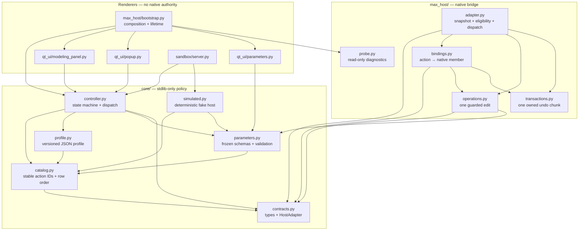
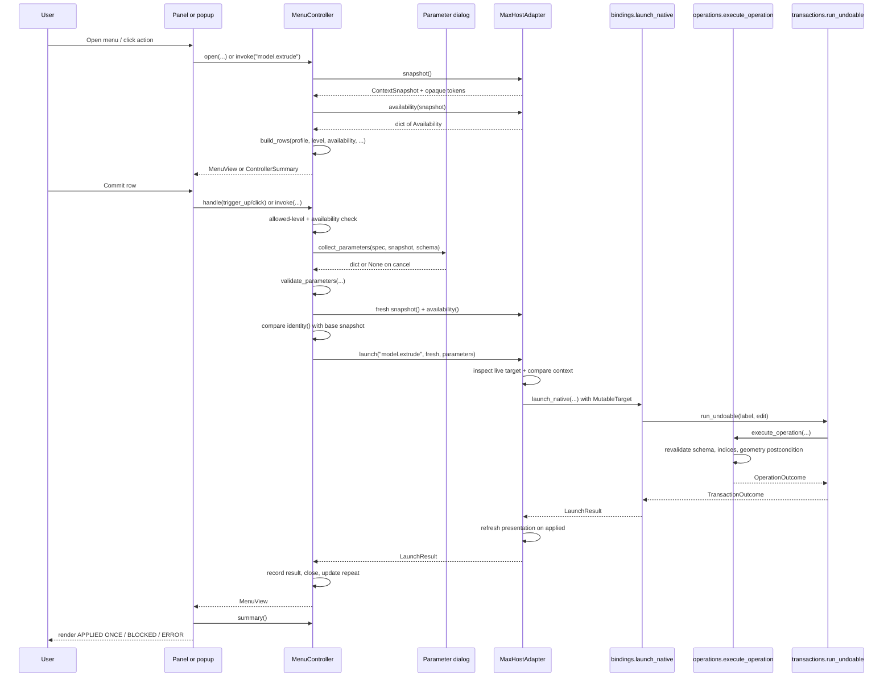
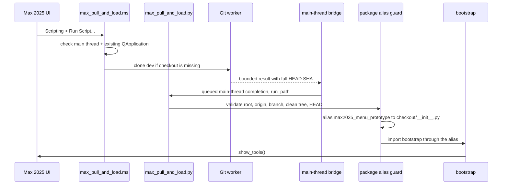

# Learning the architecture of the Max 2025 modeling prototype

This is a source-verified guide to the original prototype in this repository.
It explains what the code actually does today, not what a future modeling tool
might do. The package is experimental: every native Max operation remains
**NOT RUN** because no 3ds Max 2025 install was available to the authors. Source
tests and fake-runtime tests are evidence about this code, never evidence about
Autodesk's host.

Related reading:

- [`../README.md`](../README.md) — status, delivery options, first-launch recipes.
- [`NATIVE-MODELING.md`](NATIVE-MODELING.md) — frozen catalog, parameter, and
  lifecycle contracts.
- [`MAX2025-VALIDATION.md`](MAX2025-VALIDATION.md) — public API evidence and the
  supported/disabled matrix.
- [`VERIFICATION.md`](VERIFICATION.md) — which checks actually ran.
- [`LEARNING-HOUDINI-TO-3DSMAX.md`](LEARNING-HOUDINI-TO-3DSMAX.md) — conceptual
  bridge from procedural modeling habits to mutable Editable Poly work.
- [`plan-PolyPenPort.md`](plan-PolyPenPort.md) and
  [`plan-FirstMaxTest.md`](plan-FirstMaxTest.md) — the future-work and first-test
  plans owned by another workstream.

## 0. V2 Spotlight path (current native entry)

V2 adds a search-first path beside the frozen V1 controller. The sections below
document the V1 state machine, panel/popup/dialog, and sandbox; they remain
accurate for that legacy path and its tests, but a normal V2 launch composes none
of those widgets.

```text
core/maneuvers.json + optional checkout-root user_aliases.json
    -> core/atlas.py        strict JSON load, immutable atlas, overlay merge
    -> core/search.py       deterministic ranking + context pivots
    -> core/palette_controller.py   the only ManeuverHost caller
    -> qt_ui/palette.py     render/input/focus only; never dispatches natively
                    |
      core/maneuver_contracts.py:ManeuverHost  (snapshot/availability/execute/switch_context)
          |                           |
max_host/adapter.py:          core/maneuver_simulated.py:
ManeuverHostAdapter           SimulatedManeuverHost
    -> preparation.py (3 tiers) + maneuver_dispatch.py (fixed handlers)
    -> bindings.py / operations.py / transactions.py
```

- **`core/maneuvers.json`** holds exactly 36 stable IDs with label, group,
  aliases, contexts, and non-executable reference descriptors. Declaration order
  is the final search tie-breaker. `api`/`doc_url` are display metadata only;
  nothing in them is interpreted, fetched, or executed. The optional
  `user_aliases.json` checkout overlay may add aliases/pins/hides but can never
  change targets, contexts, or behavior, and it is git-ignored and excluded from
  portable archives.
- **`ManeuverHostAdapter`** implements the `ManeuverHost` seam over Max. It
  applies the documented prep tier (convert / preserve stack / block), takes a
  fresh snapshot, routes by destination selection count to a live native caddy
  or a zero-selection command mode, and calls one fixed reviewed handler. A
  caddy/mode result is `launched`, not proof of a geometry edit; the auto-prep
  conversion is a separate undo record from the interactive caddy. Any Edit_Poly
  modifier blocks topology editing except the explicitly confirmed *Collapse to
  Poly*. `core/maneuver_simulated.py` is the deterministic test/sandbox twin.
- **Persistent MacroScripts.** `tools/max_pull_and_load.ms` delegates to
  `tools/max_pull_and_load.py`, which writes a managed `3dsModeler.mcr`, loads it
  into the live session, and exposes the `ThreeDsModeler_Search` and context
  macros under the `3dsModeler` category in **Customize > Hotkey Editor**.
  Hotkeys are assigned manually; launch/update only reuses or rewrites owned
  macros and never removes user assignments. `bootstrap.show_palette()` is the
  native entry; `show_tools`/`show_menu`/`install_launcher` forward to it.
  `uninstall()` disposes only in-memory UI/hooks and leaves macros, hotkeys,
  native modes, scene state, and lockout intact.

All native V2 behavior remains **NOT RUN** in a real Max session; see
[`TOMORROW-MAX2025.md`](TOMORROW-MAX2025.md) for the live checklist.

## 1. What lives where

The repository root is the importable package root. There is no nested project
directory in the published layout.

| Path | Role | Runtime dependencies |
| --- | --- | --- |
| `__init__.py` | Package marker and experiment version. | None |
| `core/` | Stdlib-only policy: contracts, catalog, profile, parameters, controller, simulator. | Python standard library |
| `max_host/` | Native 3ds Max bridge: adapter, bindings, operations, transactions, probe, bootstrap. | `pymxs` only when a host call is made |
| `qt_ui/` | Qt renderers: tools panel, popup, typed parameter dialog, display helpers. | PySide6, lazily imported |
| `sandbox/` | Loopback-only HTTP renderer around `SimulatedHost`. | Standard library |
| `tools/` | Maintainer utilities (`baseline.py`, `portable.py`) and the delivered standalone launcher (`max_pull_and_load.ms`, `max_pull_and_load.py`). | Standard library |
| `tests/` | Stdlib tests, fake-runtime host tests, optional Qt tests. | Standard library; PySide6 optional |
| `docs/` | Contracts, validation evidence, interaction notes, learning material. | None |

The important architectural rule is that **`core/` never imports a renderer or a
host**. It defines the vocabulary and the state machine. Renderers and adapters
depend inward on `core/`; nothing in `core/` depends outward.

## 2. Dependency and data flow



Two seams matter more than the arrows:

1. **Core → host.** `core` sees only the `HostAdapter` protocol. Every live
   `pymxs` value stops at the adapter boundary; the core receives opaque strings,
   integers, booleans, and `LaunchResult` values.
2. **Renderer → core.** Renderers send `MenuEvent` values and read `MenuView` or
   `ControllerSummary`. They do not call `HostAdapter.launch` themselves. That
   single rule is what makes the browser sandbox, Qt popup, and Max panel share
   one behavior instead of three drifting copies.

## 3. The frozen vocabulary

`core/contracts.py` is the smallest file worth reading twice. These are the
symbols another module is allowed to rely on.

| Symbol | Module | Purpose |
| --- | --- | --- |
| `ContextLevel` | `core/contracts.py` | Six contexts: `object`, `vertex`, `edge`, `border`, `polygon`, `element`. |
| `LEVEL_ORDER` / `LEVEL_INDEX` | `core/contracts.py` | Display order and the Max sub-object level mapping `0`–`5`. |
| `ContextSnapshot` | `core/contracts.py` | Immutable host context read before a menu opens or an action dispatches. |
| `ContextSnapshot.identity()` | `core/contracts.py` | The tuple that must still match immediately before dispatch. |
| `Availability` | `core/contracts.py` | `enabled` plus a nonempty reason whenever disabled. |
| `ActionSpec` | `core/contracts.py` | One catalog action and its stable ID, group, allowed levels, repeatability, execution kind. |
| `LaunchResult` | `core/contracts.py` | One outcome with an allowlisted status: `launched`, `simulated`, `blocked`, `error`, `applied`, `cancelled`, `noop`. |
| `ParameterSpec` | `core/contracts.py` | One renderer-agnostic parameter: name, label, kind, default, bounds, enum choices, unit. |
| `HostAdapter` | `core/contracts.py` | The only protocol through which core may inspect or act on a host. |
| `MenuEvent` / `MenuRow` / `MenuView` | `core/contracts.py` | Normalized renderer input, one ordered row, and the sole rendering payload. |
| `ControllerSummary` | `core/contracts.py` | Read-only controller state for a panel; no live host values or callables. |
| `ControllerSummary.availability_for()` | `core/contracts.py` | Lookup helper over the ordered availability tuple. |

Three status meanings are easy to overread:

- `launched` means a native command mode was entered. It does **not** mean
  geometry changed.
- `applied` means the adapter completed one undoable edit and checked its own
  postcondition. It does **not** mean the operation was validated on a real Max
  install.
- `simulated` comes only from `SimulatedHost`. It is never native evidence.

`ContextSnapshot` carries `level`, `target_kind` (one of `none`,
`editable_poly`, `edit_poly`, `other`, `multiple`), opaque `target_token` and
`selection_token` fingerprints, `selection_count`, `panel_ready`,
`conflicting_mode`, and an integer `revision`. The adapter computes the tokens;
core only compares them. That is intentional: core never dereferences a Max
handle, pointer, or component index.

## 4. Catalog, profile, parameters, simulator

### Catalog

`core/catalog.py` exports `ACTIONS`, `ACTIONS_BY_ID`, `REPEAT_ACTION_ID`, and
`build_rows`. The catalog is the fixed list of action IDs. It defines groups
such as `Transform`, `Selection`, `Context`, `Modeling`, `View`, and `Repeat`,
but it does **not** define runtime eligibility. Row order comes from the profile;
eligibility comes from the adapter.

`build_rows(profile, context, availability, last_repeat_id, query)` keeps
disabled rows in place with their reason, filters only for search text, and
never applies usage-based or adaptive sorting. The `menu.repeat` row is enabled
only when the last repeatable action still exists, is allowed in the current
context, and is itself enabled.

### Profile

`core/profile.py` defines `MenuProfile`, `ProfileEntry`, `ProfileError`,
`load_profile`, `dump_profile`, and `default_profile`. Validation is strict:

- `schema_version` must be `1`.
- Exactly the six known contexts must be present.
- Every entry must contain exactly `id` and `visible`.
- Action IDs must exist and be allowed in that context.
- `tap_ms` is bounded to `100`–`600`; `neutral_px` to `4`–`48`.

Profiles contain no scripts, paths, callables, property names, or action
discovery. `default_profile()` reads `core/default_profile.json` relative to the
module, never the current working directory.

### Parameters

`core/parameters.py` is the single allowlist for parameter schemas. The public
entry points are `parameter_schema`, `requires_parameters`, and
`validate_parameters`; `ParameterError` is the failure type.

A nonempty schema means the controller must collect a concrete mapping before
dispatch. Examples from the source:

| Action | Schema |
| --- | --- |
| `model.extrude` | `height` (float, system units), `extrusion_type` (`group`, `local_normal`, `by_polygon`) |
| `model.bevel` | `height`, `outline`, `extrusion_type` |
| `model.inset` | `amount`, `inset_type` (`group`, `by_polygon`) |
| `model.chamfer` | `amount`, `open` |
| `model.connect` | vertex context: no prompt; edge context: `segments`, `pinch`, `slide` |
| `model.bridge` | `segments`, `taper`, `bias`, `twist` |
| `model.weld` | `threshold` |
| `model.collapse`, `model.remove` | `confirm` |
| `model.delete` | `confirm`; in vertex context also `cleanup` |

Validation rejects missing fields, extra fields, booleans passed as integers,
non-finite floats, magnitudes above `1_000_000`, and out-of-range values. It also
enforces operation rules: bevel height and outline cannot both be zero; inset,
chamfer, and weld amounts must be greater than zero; destructive actions require
`confirm=True`. No default is applied invisibly when a mapping is missing.

### Simulator

`core/simulated.py` defines `SimulatedHost` and `SCENARIO_NAMES`. It implements
the same `HostAdapter` surface, returns `Availability` decisions, and always
returns `LaunchResult("simulated", ...)` for accepted actions. It also blocks a
launch when the scenario's snapshot identity differs from the expected one.
`set_scenario` and `set_context` let a caller create stale-context cases without
touching geometry. The browser sandbox uses this host; the native panel does
not.

## 5. Controller lifecycle

`core/controller.py` defines `MenuController`. Its public surface for renderers
is:

| Method | Contract |
| --- | --- |
| `open(origin, time_ms, invocation)` | Open a fresh session or cancel an existing one. `invocation` is `"held"` or `"latched"`. Snapshots the host, computes availability, builds rows, and returns `MenuView`. |
| `handle(event)` | Apply one normalized `MenuEvent`. Handles triggers, pointer movement, clicks, keys, search, and cancellation. Stale session IDs and non-increasing sequences are ignored. |
| `invoke(action_id)` | Explicit panel/action entry. Revalidates a fresh snapshot and availability, then dispatches through the same commit path. Profile visibility is intentionally ignored. |
| `summary()` | Read-only `ControllerSummary` for a panel. It never performs a host query or mutation. |
| `view()` | Current `MenuView`. |
| `dispose()` | Invalidate pending input and close. |
| `set_pre_dispatch(callback)` | Renderer hook that hides a popup and restores focus immediately before native launch, after revalidation succeeds. |
| `set_parameter_prompt(callback)` | Register the synchronous parameter collector for the controller/panel lifetime. |
| `release_owned_native_mode()` | Optional public seam that asks the host adapter to exit only an exactly owned native mode. |

A held trigger release commits only when the duration reached the profile's
`tap_ms`, the pointer left the neutral zone, and a deliberately hovered row was
armed. A shorter tap **latches** the menu without arming or launching anything.
Escape, outside click, focus loss, and a second trigger press cancel. Auto-repeat
events are ignored for trigger and Enter.

`open` treats a host exception as a closed menu with a readable
`Host unavailable: ...` status. It never lets a host failure take down the
renderer. `invoke` similarly converts revalidation failure into an `error`
result.

The controller also guards parameterized work with an internal busy token. While
a parameter prompt is pending, `open`, `handle`, and `invoke` reject or ignore
new work rather than starting a second dialog or dispatch.

## 6. One invocation, end to end

Take `model.extrude` at polygon level as the example.



Step by step:

1. **Open.** `open` snapshots the host and asks for availability. It stores the
   snapshot, context, availability, and ordered rows. Nothing is mutated.
2. **Eligibility.** `ModelingPanel` shows `summary()` state and the host adapter's
   enabled/disabled decisions. A disabled row keeps its reason.
3. **Commit.** A click, Enter, or held release reaches `_commit`, or the panel
   calls `invoke`. The controller closes an unrelated open menu first.
4. **Revalidation before parameters.** `invoke` takes a fresh snapshot and checks
   the action's allowed level and availability. A parameterized action with no
   registered prompt is blocked with
   `Native parameter dialog is unavailable in this renderer.`
5. **Typed collection.** `qt_ui/parameters.py` shows one modal dialog built from
   the frozen schema. `collect_parameters` returns a plain `dict` or `None` for
   cancel; it never launches a host action.
6. **Validation.** `validate_parameters` normalizes and checks the mapping again.
7. **Revalidation after parameters.** The controller takes another fresh
   snapshot and compares `identity()` with the base snapshot. A changed
   selection, target, level, panel state, mode, or revision blocks the edit.
   Availability is checked again as well.
8. **Adapter dispatch.** `MaxHostAdapter.launch` validates the schema a second
   time, re-inspects the live target, and compares the expected context with a
   fresh one. It refuses on any mismatch.
9. **Transaction.** For an `operation` binding, `launch_native` wraps
   `execute_operation` in exactly one owned undo chunk using `run_undoable`.
10. **Postcondition.** The operation compares geometry, selection, or settings
    before and after. On success the adapter refreshes the viewport; on failure
    the adapter verifies rollback.
11. **Result.** The controller records the result, closes the menu, updates the
    repeat target only for `launched`, `simulated`, or `applied` repeatable
    actions, and returns a `MenuView`.
12. **Renderer refresh.** The panel reads `summary()` and renders the honest
    label. `describe_launch_result` maps `applied` to `APPLIED ONCE` and
    `launched` to `LAUNCHED (mode entry only; no geometry result claimed)`.

## 7. The native adapter

`max_host/adapter.py` defines `MaxHostAdapter`, the production `HostAdapter`.
The module imports `pymxs.runtime` lazily; importing it outside Max is safe.

### What counts as a target

The adapter accepts exactly one valid, unmodified, non-instanced **Editable Poly
base object**, with the Command Panel in the Modify task. It rejects:

- no selection, multiple objects, primitives, meshes, and Edit Poly modifiers;
- active Edit Poly targets;
- nonempty modifier stacks;
- shared or instanced base geometry;
- a closed or unverified Modify panel;
- unreadable `subObjectLevel`, handles, geometry, settings, hold state, or
  command mode.

The target inspection is read-only. `snapshot()` returns a `ContextSnapshot`
whose `revision` digest includes target identity, stack signature, level, raw
sub-object level, panel state, task mode, selection token, tool mode, Editable
Poly mode, command-state validity, hold state, geometry counts and digest,
settings token, current time, and node transform. Equal selection counts alone
cannot hide a topology or transform change.

### Availability

`availability(context)` iterates `CATALOG_ACTION_IDS` and looks each action up in
`NATIVE_BINDINGS`. Missing bindings receive a contextual reason from
`unverified_reason`. Level, target, mode, and membership checks then narrow the
decision. A missing native member becomes a disabled reason rather than a later
exception.

### Launch

`launch(action_id, expected_context, parameters)`:

1. rejects unknown action IDs and invalid context objects;
2. computes the parameter schema and validates parameters, or rejects parameters
   supplied to a parameterless action;
3. re-inspects and rebuilds a fresh snapshot;
4. compares level, target kind, target token, selection, selection count,
   Modify panel state, conflicting mode, and revision;
5. rechecks availability for the exact action;
6. dispatches by binding handler.

`command` and `level` handlers return `launched` after a fixed native dispatch.
`operation` handlers require the adapter's exact `MutableTarget`. `mode` and
`exit` handlers stay in the adapter so foreign modes are never toggled or exited.

### Bindings

`max_host/bindings.py` defines `NativeBinding`, `NATIVE_BINDINGS`,
`CATALOG_ACTION_IDS`, `launch_native`, `UNVERIFIED_SUBOBJECT_PREFIX`, and
`unverified_reason`. Each binding records:

- `action_id`, `handler`, `launch_kind`, `allowed_levels`;
- public documentation references;
- a live `check(context)` returning `Availability`;
- an optional fixed `dispatch` callable for command/level routes;
- `required_members`, which must exist before dispatch;
- an undo label for operations;
- `runtime_status="not_run"`.

Handlers are `command`, `level`, `operation`, `mode`, and `exit`. Only
`operation` counts as a mutation (`NativeBinding.is_mutation`). Command and level
routes are deliberately non-mutating. Transforms use fixed documented command
literals; level buttons read and write only the native sub-object level.

### Operations

`max_host/operations.py` defines `MutableTarget`, `GeometryInfo`,
`OperationOutcome`, `execute_operation`, `read_geometry`,
`read_selection_indices`, `read_settings`, `target_fingerprint`,
`bitarray_count`, `OperationError`, and `GeometryReadError`. The mutable limits
are 20,000 vertices, 20,000 faces, and 60,000 edges.

`execute_operation` revalidates the action ID, context, parameter schema, and
component indices. It dispatches only through the fixed `_HANDLERS` mapping. Each
handler performs one documented edit and then proves a postcondition: a changed
selection, changed geometry, or a reported no-op when nothing changed. Temporary
operation settings are restored inside the undo chunk.

### Transactions

`max_host/transactions.py` defines `run_undoable`, `TransactionOutcome`,
`hold_state`, `hold_reason`, and `MAX_LABEL_LENGTH`. The key fact is documented
Autodesk behavior: `pymxs.undo(True, label)` can suppress an exception while
rolling back. Therefore the code records completion **outside** the undo context
and only reports success after the context exits without an exception and the
edit callable returned an accepted outcome.

`run_undoable` never calls `run_undo()` as rollback, never clears the undo
buffer, never disables undo globally, and never adopts another tool's hold. It
creates one synchronous chunk and refuses to start while `theHold.Holding()` or
`theHold.RestoreOrRedoing()` is true.

### Rollback and the safety latch

If an operation returns `error`, the adapter compares a pre-edit fingerprint with
the post-failure fingerprint. If the pre-edit geometry, selection, and settings
were restored, the error is reported without disabling the host. If they differ,
the adapter latches native topology disabled: all mutation bindings become
unavailable until the adapter is reinitialized. The guidance is to inspect the
scene and use Max Undo manually, never to run a blind undo, retry, reset the
adapter, or weaken the guard.

This latch is a safety response to an unverifiable rollback, not a transaction
log or an automatic recovery system.

### Viewport refresh

After an `applied` operation, `_refresh_presentation` calls `redrawViews` or
`completeRedraw` when available. A refresh failure does not roll the geometry
back; it returns the same result status with a message saying the viewport
refresh failed.

## 8. Owned interactive modes

`model.cut` and `model.target_weld` are interactive mode entries, not immediate
edits. They are handled by the adapter:

- `toggleCommandMode` enters the documented mode;
- `getCommandMode` is read back;
- ownership is recorded only when the observed mode matches the requested mode;
- a different active Editable Poly command mode is blocked, never toggled;
- repeating the same owned mode is idempotent.

`model.exit_tool` exits only the mode the adapter itself entered on the exact
same target token. If ownership is absent, stale, or no longer active, it
returns `blocked`. The public `release_owned_mode()` method is the uninstall
seam; `MenuController.release_owned_native_mode()` calls it only when the host
adapter exposes it. Bootstrap's uninstall path uses that controller method and
never reaches into private adapter fields or exits a user-owned tool.

## 9. Diagnostics

`max_host/probe.py` exports `build_report` and `report`. Both accept an optional
runtime, an optional cached `summary`, and `include_details`. They:

- assert the Max main thread before any host access;
- report cached controller state separately from a fresh temporary observation;
- skip all fresh host probing when the summary is busy;
- never mutate geometry, create a controller, refresh a menu, or dismiss a
  pending dialog;
- omit names, paths, handles, component data, parameter values, and arbitrary
  exception text by default;
- expose bounded private details only with `include_details=True` for local
  review.

`bootstrap.report_diagnostics()` reads the existing controller through
`summary()` only. It does not create a panel or controller when none exists. A
report is documentation of state, not proof that an operation works.

## 10. UI lifetime and threading

The native composition lives in `max_host/bootstrap.py`:

| Public function | Effect |
| --- | --- |
| `show_tools(controller=None)` | Compose the adapter, default profile, controller, parameter prompt, and one `ModelingPanel`; show and raise it. |
| `show_menu(controller=None)` | Open the shared latched popup at the cursor. |
| `install_launcher(controller=None)` | Click-to-open alias for `show_tools`; the old hold launcher is retired. |
| `uninstall()` | Close pending dialogs, clear the prompt hook, dispose prototype widgets, release only an owned native mode, and dispose the controller. |
| `report_diagnostics(include_details=False)` | Read-only diagnostics via `summary()` and `probe.report`. |

Qt and `pymxs` imports are inside functions. Module-level strong references keep
the controller, panel, popup, prompt callback, and parameter module alive while
Max owns the parent window. `ModelingPanel` requires an existing `QApplication`
and the GUI thread; it never creates a second application. `MenuPopup` is a
renderer with latched entry and no trigger-release input.

`ModelingPanel` has one shared controller, a `menu_requested` signal, a
read-only refresh callback, and `dispose()`. Closing the tool window hides it;
bootstrap keeps the shared instance for repeated show/uninstall. `dispose()` is
idempotent and never touches the controller. The parameter dialog is modal and
one-shot; `collect_parameters` returns `None` on cancel, and
`close_pending_dialogs()` is the bounded teardown path.

The bootstrap's "Refresh context" path is read-only. Because the frozen
controller has no separate refresh entry, it opens a latched snapshot and
immediately cancels it with a `MenuEvent`, skipping while a menu or parameter
request is active.

## 11. The browser sandbox

`sandbox/server.py` defines `SandboxServer` and `sandbox/__main__.py` is the CLI
entry. The server:

- binds loopback only;
- creates one `MenuController` and a cloned profile per browser session;
- uses `SimulatedHost` as the only host;
- returns a state payload containing the `MenuView`, profile, action metadata,
  simulated snapshot, and scenario list;
- marks payloads with `"simulated": True`.

It never imports `pymxs` or the Max adapter. There is no browser-to-Max control
path. A browser click can drive a simulated host or a sandbox controller, but it
cannot reach a native scene.

## 12. The outer delivery/import seam

The modeling architecture above starts at `bootstrap.show_tools()`. A separate,
outer seam delivers the source from GitHub into Max without depending on a
manual `sys.path` edit. The launcher files are part of this repository and are
source-tested on this host; their Max execution remains **NOT RUN**. The public
surface below is frozen by contract.

Frozen public surface in `tools/max_pull_and_load.py`:

```python
PACKAGE_NAME = "max2025_menu_prototype"
REPO_URL = "https://github.com/nekirk11/3dsModeler.git"
BRANCH = "dev"
DEFAULT_CHECKOUT = Path(r"C:\dev\3dsModeler")

class LauncherError(RuntimeError): ...

def start(*, checkout: Path = DEFAULT_CHECKOUT) -> None: ...
def load_checkout_package(checkout: Path, head_sha: str) -> ModuleType: ...
```

`tools/max_pull_and_load.ms` is the standalone MAXScript entry for
**Scripting > Run Script...**. It embeds a small clone bootstrap, then delegates
to the Python companion. The intended flow is:



The Git worker performs no `pymxs` or Qt widget calls. Only the queued
main-thread completion path validates the checkout, loads the alias, imports the
host modules, or touches the UI. A worker exception is reported as a bounded
failure category, not as an arbitrary host instruction.

The alias is the delicate part. The checkout directory is literally
`3dsModeler`, while the Python package name is `max2025_menu_prototype`. The
launcher must not rename the package, add a nested package directory, add
`C:\dev\3dsModeler` to `sys.path`, or delete unrelated modules. It uses
`importlib.util.spec_from_file_location` with the package name and
`submodule_search_locations=[str(checkout)]`, registers the package in
`sys.modules` before executing it, and then imports `max_host.bootstrap` through
the alias. Every existing root and submodule is checked against the expected
checkout tree and a session stamp; a stale submodule is as fatal as a stale
root.

On the same root and same HEAD, the launch is idempotent: reuse the loaded
modules and raise the existing panel. On a changed HEAD, the launcher sets a
persistent restart-required state, calls the **already-loaded trusted**
`bootstrap.uninstall()`, and refuses further imports or UI in that Max session.
It does not hot-reload and does not import changed files to clean up. The next
Max process is the supported way to load a new commit.

There are three distinct delivery layouts:

| Layout | Package root | Import mechanism | Switch rule |
| --- | --- | --- | --- |
| Git launcher (delivered) | `C:\dev\3dsModeler` | Alias with `spec_from_file_location` | New Max session after an update |
| Portable ZIP | `C:\MaxTools\TestReadiness\max2025_menu_prototype` | Parent directory on `sys.path` | New Max session when changing copies |
| Source checkout | Repository root containing `max2025_menu_prototype/` | Parent directory on `sys.path` | Development only; not the published Git layout |

Do not mix them in one Max process. A successful panel launch also does not
prove native geometry support.

## 13. What each layer proves

| Layer | What it can prove | What it cannot prove |
| --- | --- | --- |
| `core/` stdlib tests | State transitions, profile/schema validation, stale-context rejection, repeat semantics, simulated dispatch. | Any Max behavior. |
| V2 atlas/search/palette-controller tests | 36-ID validation, overlay fallback, deterministic ranking/pivots, single-dispatch and confirmation semantics. | Widget focus in Max, native caddy behavior. |
| V2 fake-host/preparation/dispatch tests | 3-tier routing, count routing, fixed handler registry, clean-dissolve preconditions, rollback lockout. | Autodesk return types, live caddies/modes, undo grouping. |
| Fake-runtime `max_host/` tests | Adapter contract, guard order, transaction bookkeeping, rollback branches, fake `pymxs` return handling. | Autodesk return types, real component indices, viewport focus, undo grouping, command-mode behavior. |
| Optional Qt tests | Widget composition and controller wiring when PySide6 is present. | Max focus, DPI, viewport input, host parenting. |
| Browser sandbox | One shared controller behind a loopback HTTP renderer. | Native control; every host result is simulated. |
| Probe | Read-only diagnostic state. | Operation success. |
| Real Max run | Host behavior, if actually executed and recorded. | Anything not exercised by that run. |

The repository therefore treats `runtime_status="not_run"` as a hard boundary.
No amount of source or fake-runtime success promotes it.

## 14. Guided read order

1. [`../README.md`](../README.md) — status and delivery.
2. §0 above, then `core/atlas.py` → `core/search.py` →
   `core/palette_controller.py` → `max_host/preparation.py` →
   `max_host/maneuver_dispatch.py` for the current V2 path.
3. [`NATIVE-MODELING.md`](NATIVE-MODELING.md) — frozen contracts and acceptance
   cases.
4. `core/contracts.py` — vocabulary and the host protocol.
5. `core/catalog.py`, then `core/profile.py`, then `core/parameters.py` — what can
   be offered, in what order, with what inputs.
6. `core/controller.py` — the V1 state machine and dispatch path.
7. `core/simulated.py` — the fake host used by the sandbox.
8. `max_host/adapter.py` — target inspection, eligibility, and dispatch guard.
9. `max_host/bindings.py` — the fixed action-to-native mapping.
10. `max_host/operations.py` — one guarded edit and its postcondition.
11. `max_host/transactions.py` — one owned undo chunk and the suppressed-exception
    problem.
12. `max_host/probe.py` — read-only diagnostics.
13. `max_host/bootstrap.py` — composition, lifetime, and teardown.
14. `qt_ui/palette.py`, `qt_ui/palette_model.py` — V2 renderer; then
    `qt_ui/modeling_panel.py`, `qt_ui/parameters.py`, `qt_ui/popup.py` — V1.
15. `sandbox/server.py` — the simulation boundary.
16. [`MAX2025-VALIDATION.md`](MAX2025-VALIDATION.md) and
    [`VERIFICATION.md`](VERIFICATION.md) — evidence and NOT RUN status.
17. [`LEARNING-HOUDINI-TO-3DSMAX.md`](LEARNING-HOUDINI-TO-3DSMAX.md), then the
    future-work plans.

## 15. Where the future polygon tool would attach

No polygon-drawing tool exists in this delivery. The proposed future seam is:

- `core/polygon_draft.py` — host-neutral immutable intents and draft state;
- `max_host/polygon_draw.py` — viewport ray/hit queries and one validated commit;
- renderers propose intents; only the native adapter commits geometry.

That design is deliberately separate from the current menu controller. It does
not reuse another host's element references or procedural history, and it does
not silently add action IDs, Repeat behavior, or private adapter fields. See
[`plan-PolyPenPort.md`](plan-PolyPenPort.md) for the milestones, feasibility
gates, and explicit unknowns.
