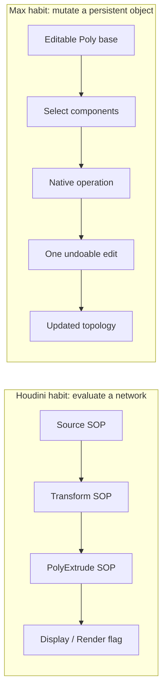
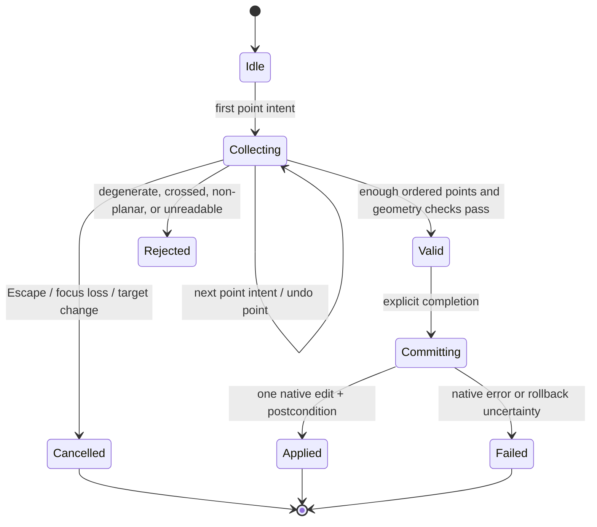

# From Houdini to 3ds Max 2025: a conceptual translation guide

This guide is an independently written comparison for someone who knows
procedural modeling in Houdini and wants to reason about a mutable-polygon tool
in 3ds Max 2025. It is based on public Autodesk and SideFX documentation, not on
any proprietary implementation. It does not translate source code, promise
feature parity, or claim that a polygon tool already exists here.

Read it alongside [`LEARNING-ARCHITECTURE.md`](LEARNING-ARCHITECTURE.md), which
describes the prototype that **does** exist, and
[`plan-PolyPenPort.md`](plan-PolyPenPort.md), which describes the proposed future
polygon seam. Every host, viewport, and geometry claim in this guide remains
**NOT RUN** unless a real Max session records it.

## 1. Two different centers of gravity

Houdini modeling is usually described as a network that cooks geometry. A SOP
network wires generators and modifiers together; the display flag decides which
node's output the viewer shows. Changing an upstream parameter causes downstream
nodes to cook again. A node's output is a result of its inputs and parameters.

3ds Max polygon modeling is usually described as editing an object that persists.
An Editable Poly has a base object with vertices, edges, faces, and elements.
Sub-object operations mutate that topology in place. The modifier stack can add
non-destructive evaluation above the base object, and the native Undo system
records chronological edits.

Neither model is a superset of the other. The useful question is not "which is
better" but "which assumptions from one model stop being true in the other?"

## 2. Vocabulary map

The right-hand column is this project's vocabulary, not an Autodesk or SideFX
term, unless it is marked as a public API name.

| Houdini public concept | 3ds Max public concept | What changes for a tool | Project concept |
| --- | --- | --- | --- |
| Geometry detail | Object / base object / scene node | A detail is evaluated data; a Max node persists and can have a modifier stack. | `ContextSnapshot` target identity |
| Primitive (polygon, NURBS, volume, packed primitive) | Object, base object, face / polygon, element | "Primitive" is broader in Houdini than "polygon face" in Max. | `ContextLevel.POLYGON` / `ELEMENT` |
| Point with attributes, including `P` | Vertex position in a mesh / Editable Poly | Houdini separates points from the vertices that reference them; Max vertex indices are the mesh's own numbering. | Opaque selection and target tokens |
| Vertex as a per-primitive corner reference | Face corner / mesh vertex index | Houdini vertices are unique to a primitive; points can be shared. Max face and edge indices have their own topology rules. | Component index tuples inside the adapter |
| Primitive / point / vertex / detail attributes | Geometry channels, UVs, normals, vertex data | Attribute precedence and storage differ; not every Houdini attribute has a direct Max equivalent. | Parameter values and operation settings |
| Point / primitive / edge / vertex groups and patterns | Component selection as a `BitArray` | Houdini groups are named or pattern-based; Max selection is live state and is usually a bitarray. | `selection_count` and `selection_token` |
| SOP network | Modifier stack or Editable Poly sub-object editing | A SOP network re-cooks; a Max edit changes stored topology. | `model.*` actions |
| Display flag / render flag | Viewport display, render properties | Houdini chooses which node output to show; Max shows the scene object and its stack. | Not modeled |
| HDA / viewer state | Max command mode / Qt panel / viewport tool | Interactive ownership and cancellation rules are host-specific. | `model.cut`, `model.target_weld`, `model.exit_tool` |
| HOM (`hou`) Python API | `pymxs` and Max Python APIs | Both expose host objects, but object models and threading rules differ. | Lazy `pymxs.runtime` behind `HostAdapter` |
| Geometry spreadsheet | Listener, scripted inspection, native panels | Diagnostics and privacy expectations differ. | Read-only `probe.report` |

Two vocabulary traps deserve emphasis:

1. **Houdini "vertex" is not Max "vertex."** In Houdini a point is a position in
   space and a primitive's corner is a vertex that references a point. Several
   primitives can share a point while each has its own vertex. In Max, a mesh
   vertex is usually what a modeler selects, and a face is defined by its own
   vertex and edge lists. A one-to-one index translation is therefore wrong.
2. **"Primitive" is overloaded.** Houdini uses it for polygons, curves, volumes,
   packed geometry, and more. Max uses "primitive" for procedural objects such as
   Box or Sphere, and "polygon" or "face" for a mesh face. The project separates
   these as `target_kind` (`editable_poly`, `edit_poly`, `other`, `multiple`,
   `none`) rather than pretending they are the same thing.

## 3. Cooked results versus mutable edit history

A procedural network answers "what is the output of these inputs?" A mutable
polygon object answers "what does the object contain now, and what edit changed
it?"

| Question | Houdini-style answer | Max-style answer |
| --- | --- | --- |
| Where did this face come from? | Trace upstream nodes and parameters; re-cook. | Inspect the base object, stack, and undo history. |
| How do I change it? | Change an upstream parameter or insert a node. | Select components and run an operation, or add a modifier. |
| What happens on failure? | The cook may fail, leave a cache, or pass through. | The native edit may partially apply; undo and rollback must be verified. |
| What is stable? | Node paths and parameter expressions are the usual references. | Node handles and component indices are live host state. |
| How is repetition expressed? | Reuse a node, asset, or network. | Repeat the last command, or use a modifier/script. |

The prototype's adapter is firmly in the second column. It reads a live context,
revalidates it, runs one operation in one undo chunk, and checks a postcondition.
It does not replay a node graph, retain a procedural history, or regenerate a
mesh from parameters.

This difference is why a "port" of an interactive tool must be an independent
re-expression of user-visible goals, not a translation of an implementation. A
procedural tool can often be tested by evaluating a graph twice. A mutable tool
must be tested against selection changes, target changes, undo behavior, focus,
and partial failure.

## 4. Points, vertices, faces, and index spaces

Houdini geometry is commonly described as details, primitives, points, vertices,
and attributes. The public docs are explicit that:

- a point is a position with attributes, including `P`;
- a vertex is a reference to a point and is unique to a primitive;
- primitives use vertices to reference points;
- primitives can share points;
- attributes can live on vertices, points, primitives, or the detail, with
  vertex attributes taking precedence over point, primitive, and detail
  attributes.

3ds Max Editable Poly exposes its own sub-object levels. The project maps them as:

| Project level | Max sub-object level | Public native concept |
| --- | --- | --- |
| `object` | `0` | Object / base-object level |
| `vertex` | `1` | Vertex |
| `edge` | `2` | Edge |
| `border` | `3` | Border (open edge loop) |
| `polygon` | `4` | Polygon / face |
| `element` | `5` | Element (connected polygon group) |

Two index lessons follow:

1. **A Houdini point number is not a Max vertex index.** Even if both are
   integers and both start at zero or one, they belong to different topology
   models. The public Max docs note that some Python-facing indices are 1-based;
   assumptions must be checked against the specific API, not inferred from
   Houdini habits.
2. **A Max component index is mutable.** Deleting, collapsing, welding, or
   changing the target can renumber vertices, edges, and faces. Holding an old
   index and applying a second operation to it is how a tool edits the wrong
   component or crashes.

The prototype never passes raw indices across a topology change. The adapter
writes an opaque `selection_token` and a `revision` into `ContextSnapshot`;
before dispatch it re-reads the host and compares the whole identity. If anything
moved, the operation is blocked.

## 5. Selection: groups and patterns versus bitarrays

In Houdini, component selection and groups are closely related. You can select
points, primitives, edges, or vertices in the viewer, create named groups, and
use group patterns in node parameters. A group can persist as part of the
geometry and can be reused by later nodes.

In Max, component selection is live object state. The public Editable Poly API
returns selection bitarrays, for example `polyop.getVertSelection`,
`polyop.getEdgeSelection`, and `polyop.getFaceSelection`. A `BitArray` is a
compact membership set, not a named group with an expression syntax.

| Intent | Houdini habit | Max reality | Project handling |
| --- | --- | --- | --- |
| "These points" | Point group or point numbers | Vertex selection bitarray | Read indices, count them, store an opaque token |
| "Faces with this material" | Primitive group or attribute pattern | Face selection or material lookup | Explicit action; not assumed by the menu |
| "Grow selection" | Group Expand or attribute logic | Native selection operation | `selection.grow` binding |
| "Edge loop" | Edge group / loop selection | Native edge loop operation | `selection.loop` / `selection.ring` |
| "Remember this set" | Named group with geometry scope | Selection is transient unless stored by the tool | Not implemented |

A renderer must also distinguish "zero selected components" from "selection could
not be read." Houdini's group pattern may simply match nothing; a Max API can
throw, return `undefined`, or return an unreadable object. The prototype treats
an unreadable selection as a blocked target and refuses mutation.

## 6. Coordinates, units, spaces, and hit testing

Both products have object/local space, world space, and a scene unit system, but
the details are not interchangeable.

| Concern | Houdini public concept | Max public concept | Design consequence |
| --- | --- | --- | --- |
| Position | `P` point attribute | Vertex position; node transform | Convert deliberately; do not assume identical axes or handedness. |
| Object space | Geometry local coordinates | Object/local coordinates | A face built from viewport hits must end up in the right local space. |
| World space | Transform applied by object | World transform | Parent/instance transforms can change the mapping. |
| Units | Scene unit setting | System units and display units | A numeric height is meaningless without its unit contract. |
| Screen to geometry | Viewer ray / construction plane | Viewport ray / hit test | The public Python path is not assumed; this is a feasibility question. |
| Depth | Ray parameter / hit position | Ray depth / hit point | Overlapping geometry makes depth selection a user-visible decision. |
| Snapping | Point snapping / construction plane | Grid, snap, and vertex snapping | Tolerance and precision must be explicit. |

The project's parameter schema labels linear values as "system units" rather than
pretending they are meters or generic units. A future polygon tool would have to
answer, before any commit:

- Is the input a screen point, a construction-plane point, a world point, or a
  local point?
- What happens when the ray misses geometry or hits the back face?
- What is the snap radius in screen pixels versus scene units?
- How is a non-planar or self-intersecting face rejected?
- Which coordinate space is stored, and which is recomputed at draw time?

None of those answers can be borrowed from Houdini's viewer state model. They
must be verified against Max's public Python interfaces.

## 7. Interaction and mode ownership

Houdini's public Python viewer-state API is explicitly about interaction: a state
can interpret mouse movement, clicks, and keys; draw guide geometry; select
geometry; show a custom context menu; and wrap changes in undo blocks. That is a
host-provided interaction framework.

Max also has command modes and a command panel, but its public Python surface
works through host command modes and object interfaces rather than a dedicated
viewer-state framework of the same shape. The prototype uses documented Editable
Poly calls to enter and leave modes:

- `EditablePoly.toggleCommandMode(...)`;
- `EditablePoly.getCommandMode()`;
- `EditablePoly.exitCommandModes()`.

The adapter records ownership as a pair of target token and observed mode. It
exits only that exact owned mode. It does not toggle or cancel a mode owned by a
different tool, even if that mode blocks its own action. `model.exit_tool` and
`release_owned_mode()` are the only exit paths, and both return `blocked` when
ownership cannot be proven.

A future drawing tool should copy the safety principle, not the implementation:

- own only what you entered;
- read the mode back and compare it;
- never "clean up" by forcing a foreign tool out of its state;
- treat focus loss, target change, and revision change as cancellation or block
  conditions, not as invitations to retry.

Threading is another hard boundary. Houdini's Python states run inside the host's
event loop. The prototype treats `pymxs.runtime` access as main-thread-only. It
asserts the main thread in the adapter and probe, keeps Git/network work off the
host, and requires an existing `QApplication` on the GUI thread. It never creates
a second application and never calls `pymxs` from a worker.

## 8. Identity, revision, and stale references

Procedural systems often have a convenient notion of "the same point" because a
node re-cooks from stable inputs. Mutable systems do not. Houdini's own public
attributes documentation warns that element numbers can change; it recommends an
`id` attribute when point numbers must be tracked across changes. The same lesson
applies with more force in Max.

| Reference kind | Houdini | Max | Project rule |
| --- | --- | --- | --- |
| Object identity | Node path / op path | Node handle, object reference | Opaque `target_token` |
| Component identity | Point/primitive number; optional `id` attribute | Vertex/edge/face index | Opaque `selection_token` |
| Change detection | Cook version / topology difference | Revision digest, topology, selection state | `ContextSnapshot.identity()` |
| Persistence | Saved in the HIP file | Saved in the scene; handles are live state | Never persist raw indices in the menu |
| Selection | Group membership or live selection | Live bitarray | Re-read after every edit |

The prototype's revision digest includes the target, stack signature, level, raw
sub-object level, panel state, task mode, selection token, tool mode, Editable
Poly mode, command-state validity, hold state, geometry counts and digest,
settings token, time, and transform. That is deliberately over-inclusive: a
false block is safer than editing a different face than the user selected.

## 9. Transactions, rollback, and postconditions

This is the area where a direct analogy is most tempting and most misleading.

| Property | Houdini-style procedural work | Max-style mutable edit | Project decision |
| --- | --- | --- | --- |
| Unit of change | Cook / node evaluation | User operation / undo chunk | One owned undo chunk per immediate operation |
| Failure behavior | Cook error or pass-through | Partial edit possible; undo context may suppress exceptions | Record completion outside the undo context |
| Undo | Host undo stack; state handlers can wrap undo blocks | Native Max undo buffer | Use one `pymxs.undo` chunk, never a blind rollback |
| Verification | Re-evaluate and compare output | Re-read geometry, selection, and settings | Operation-specific postcondition |
| Recovery | Re-cook or fix the network | Manual Undo / inspect scene | Explicit rollback verification, then a safety latch |
| Repeat | Re-run a network or node | Repeat last command | Controller-owned `menu.repeat` |

The critical Max detail is documented by Autodesk: a `pymxs.undo` context can
roll back an exception **and suppress it**. A function that returns success from
inside the block can therefore report success after a failed edit. The prototype
handles this by recording the outcome outside the context and inspecting it only
after the context exits. If the edit failed, it compares a pre-edit fingerprint
with the post-failure state. If rollback is incomplete, it latches mutation
disabled rather than guessing with another undo.

This is not a transactional database and not a promise of atomicity. It is a
defensive wrapper with a truthful failure message. A future drawing tool should
use the same rule: one accepted face or boundary extension should be one native
undo unit, and a failed commit must not leave the tool claiming success.

## 10. What transfers, what must be redesigned, what is unknown

### Transfers as a design habit

- Separate intent and state from the host call.
- Validate before mutating.
- Make selection and target semantics explicit.
- Revalidate immediately before commit.
- Keep one user action tied to one undo unit.
- Make cancel produce no scene or history change.
- Keep diagnostics read-only.
- Treat preview and commit as different states.

### Must be redesigned for Max

| Houdini habit | Why it does not transfer directly |
| --- | --- |
| SOP network as the tool's state | Max Editable Poly edits mutate persistent topology; the project supports an unmodified base object, not a procedural graph. |
| Point/vertex/primitive numbering | Max has its own vertex, edge, face, and element indices with different sharing rules. |
| Group patterns | Max uses live component selection and bitarrays; named groups are not the same mechanism. |
| Viewer-state framework | Max's public Python interaction surface and viewport ownership rules are different and partly unproven. |
| Cook failure semantics | Max can partially apply an edit; rollback must be verified. |
| Node/attribute identity | Max component indices are mutable; a revision/token scheme is required. |
| Units and coordinate assumptions | Both products have configurable units and spaces; never hard-code a conversion. |

### Remains unknown without a real host

- Whether public Python can safely capture the viewport input needed for a
  drawing tool.
- Whether screen-to-ray and ray-to-local hit testing are available and precise
  enough through public APIs.
- Whether face creation from ordered points is supported without private or C++
  interfaces.
- How focus, DPI, viewport redraw, and command-mode changes affect a pending
  draft.
- How a modifier stack or instanced geometry should be rejected or supported.
- How component indices behave across every topology-changing operation.
- Whether native Undo groups a multi-step commit the way a user expects.

The honest answer to these is **NOT RUN**, not "probably fine." The proposed plan
requires a feasibility spike on disposable fixtures before any interactive tool
is promised.

## 11. Public sources and retrieval notes

Public pages were retrieved on **2026-11-11**. SideFX pages displayed Houdini
22.0 at retrieval. Autodesk pages are the MAXScript/Python 2025 help where
available; older archived MAXScript pages are flagged because the 2025 viewer
does not expose that content.

### SideFX (public manuals)

- Houdini Python scripting / HOM overview:
  <https://www.sidefx.com/docs/houdini/hom/index.html>
- Writing custom viewer states in Python:
  <https://www.sidefx.com/docs/houdini/hom/python_states.html>
- Geometry (SOP) networks:
  <https://www.sidefx.com/docs/houdini/nodes/sop/index.html>
- Points and vertices:
  <https://www.sidefx.com/docs/houdini/model/points.html>
- Primitives:
  <https://www.sidefx.com/docs/houdini/model/primitives.html>
- Geometry attributes (including the `id` attribute and attribute precedence):
  <https://www.sidefx.com/docs/houdini/model/attributes.html>

### Autodesk (public 3ds Max documentation)

- 3ds Max 2025 Python Developer Help, Using pymxs:
  <https://help.autodesk.com/cloudhelp/2025/ENU/MAXDEV-Python/files/MAXDEV_Python_using_pymxs_html.html>
- 3ds Max 2025 Python Developer Help, `pymxs` module (undo rollback and
  exception suppression):
  <https://help.autodesk.com/cloudhelp/2025/ENU/MAXDEV-Python/files/using_pymxs/MAXDEV_Python_using_pymxs_pymxs_module_html.html>
- 3ds Max 2025 Python Developer Help, Threading in Python with 3ds Max:
  <https://help.autodesk.com/cloudhelp/2025/ENU/MAXDEV-Python/files/MAXDEV_Python_threading_html.html>
- 3ds Max 2025 MAXScript Help, Interface: EditablePoly:
  <https://help.autodesk.com/cloudhelp/2025/ENU/MAXScript-Help/files/3ds-Max-Objects-and-Interfaces/Editable-Meshes-Splines-Patches/Editable_Poly/GUID-90843EC5-AE3A-43EB-9406-A3631DAEADEF.html>
- 3ds Max 2025 MAXScript Help, Editable_Poly properties:
  <https://help.autodesk.com/cloudhelp/2025/ENU/MAXScript-Help/files/3ds-Max-Objects-and-Interfaces/Editable-Meshes-Splines-Patches/Editable_Poly/GUID-0196A023-116F-47F8-99E9-AF3CB52F302C.html>
- 3ds Max 2025 MAXScript Help, Editable_Poly Extrude, Bevel, and Chamfer
  methods:
  <https://help.autodesk.com/cloudhelp/2025/ENU/MAXScript-Help/files/3ds-Max-Objects-and-Interfaces/Editable-Meshes-Splines-Patches/Editable_Poly/Editable_Poly-Methods/GUID-942EDBDB-D13B-4D37-8098-868EFA68BA6E.html>
- 3ds Max 2025 MAXScript Help, Editable_Poly Get/Set Selection methods:
  <https://help.autodesk.com/cloudhelp/2025/ENU/MAXScript-Help/files/3ds-Max-Objects-and-Interfaces/Editable-Meshes-Splines-Patches/Editable_Poly/Editable_Poly-Methods/GUID-37771642-5CC2-49F3-B77F-4F390E7ABD9E.html>
- 3ds Max 2025 MAXScript Help, BitArray values:
  <https://help.autodesk.com/cloudhelp/2025/ENU/MAXScript-Help/files/MAXScript-Language-Reference/Collections/Collection-Types/GUID-0F53E04C-0760-4B9C-A1BE-0E53162DE479.html>
- 3ds Max MAXScript Help, Modify panel (`subObjectLevel`,
  `modPanel.getCurrentObject`) — **archived older page; 2025 viewer
  unavailable**:
  <https://help.autodesk.com/cloudhelp/2016/ENU/MAXScript-Help/files/GUID-BAC3CC23-9D1D-44CE-B4AF-C0CEBDD7099E.htm>
- 3ds Max MAXScript Help, 3ds MAX commands (fixed command literals) —
  **archived older page; 2025 viewer unavailable**:
  <https://help.autodesk.com/cloudhelp/2017/ENU/MAXScript-Help/files/GUID-A96857E7-73FE-4F42-BE71-E8185356F4C9.htm>

These sources describe public host concepts. They do not validate this
prototype's source, its guards, or any operation in a real Max session. The
project's evidence boundary remains: source tests and fake-runtime tests are
local code evidence; native behavior is **NOT RUN**.

## 12. Where to go next

- Read [`LEARNING-ARCHITECTURE.md`](LEARNING-ARCHITECTURE.md) for the actual
  controller, adapter, transaction, and launcher seams in this repository.
- Read [`plan-PolyPenPort.md`](plan-PolyPenPort.md) for the proposed polygon
  milestones, feasibility spike, and explicit de-scope conditions.
- Read [`plan-FirstMaxTest.md`](plan-FirstMaxTest.md) for the first real Max
  session and its stop gates.
- Read [`MAX2025-VALIDATION.md`](MAX2025-VALIDATION.md) after any host run and
  record what actually happened rather than promoting an untested assumption.

## 13. Exercise: one face intent through a host-neutral draft and a native commit

This is a paper exercise. No polygon-drawing code exists here, and the guide does
not provide executable topology code.

### Scenario

The user has one valid, unmodified Editable Poly, is at polygon level, and clicks
four points in the viewport to create one quad. The goal is to show where
Houdini habits help and where they must stop.

### Proposed host-neutral types

These names come from the future-work plan, not from the current package:

- `PointIntent` — an immutable record of one user click: screen position, depth
  or hit reference, time, and the target revision it was collected against.
- `PolygonDraft` — an ordered sequence of intents, a closed/open flag, and a
  validation state.
- `DraftResult` — accepted or rejected, with a reason and any normalized geometry
  description needed for rendering.

The renderer proposes intents. Only the native adapter may commit geometry.

### Trace

1. **Preconditions.** The adapter verifies one supported base object, polygon
   level, Modify panel, no conflicting mode, readable geometry, and a safe undo
   hold state. If any check fails, the draft never starts.
2. **Collect intents.** The renderer records ordered point intents. It does not
   edit geometry, create an undo chunk, or write to the modifier stack.
3. **Normalize.** The draft converts each intent to the target's local space,
   applies the agreed snap tolerance, and checks for duplicate, collinear, or
   self-intersecting points. The exact tolerance and plane behavior are design
   decisions, not Houdini defaults.
4. **Validate.** The draft rejects fewer than three points, a degenerate face,
   an unclosed polygon when a closed face is required, and any point collected
   against a different revision.
5. **Revalidate the target.** Immediately before commit, the adapter re-reads the
   snapshot. A changed selection, target, level, stack, mode, time, or transform
   blocks the commit.
6. **Commit once.** The native adapter creates exactly one face from the
   validated ordered points in local space. It must not create a face, fail, and
   then create a second one during a retry.
7. **Postcondition.** The adapter proves that the expected face count or topology
   changed, and refreshes the viewport. If the edit fails, it verifies rollback
   and follows the same safety-latch policy as the existing operations.
8. **Cancel.** Escape, focus loss, target change, or a validity failure makes no
   scene edit and no undo entry. The draft is discarded.

### Questions to answer before implementation

- Does the first click define the construction plane, or does the target's local
  plane define it?
- What happens when a click misses the mesh?
- Is a non-planar quad accepted, triangulated, or rejected?
- What is the winding rule, and how are normals computed?
- Does the tool reject a face that duplicates existing topology?
- How does the user edit or remove the last point?
- What exactly is one undo unit: each point, or the completed face?
- What happens if the target topology changes between the third and fourth click?
- How is preview drawn without creating committed geometry?

None of these answers should be invented from Houdini experience. They belong in
the feasibility spike and the proposed design record.
