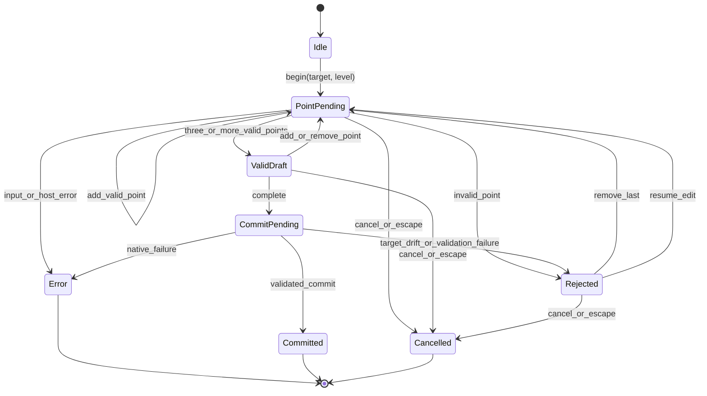

# Plan: independent polygon-drawing port (working name "PolyPen")

**Status: PLANNING ONLY — NOT IMPLEMENTED.** No polygon-drawing source is
added by this delivery. Every host, viewport, input, geometry, and Undo claim
below is **NOT RUN**. This document is a proposal and a feasibility plan, not a
feature announcement.

"Port" here means an **independent re-expression of user-visible modeling
goals**. It is not a translation of another implementation, not a promise of
feature parity, and not permission to copy code, comments, identifiers, assets,
or internal behavior. The design names below are newly chosen for this project.

## 1. Scope

### 1.1 Initial user goals

| ID | Goal |
| --- | --- |
| G1 | Create one valid face from an ordered sequence of explicit point intents |
| G2 | Extend one verified open boundary segment into a quad or a triangle |
| G3 | Complete or cancel the draft explicitly, with no accidental edit |

The first scope is deliberately small. A draft is point-by-point, not freehand.
Only one target is active at a time. Completion creates or extends one face; it
does not continue into a modeling session.

### 1.2 Deferred until host feasibility is demonstrated

- freehand retopology and stroke smoothing;
- surface projection or shrink-wrap onto an arbitrary surface;
- automatic bridging between separate boundaries;
- welding, merging, or tolerance-based point snapping into existing vertices;
- symmetry, mirroring, and multi-target editing;
- exact parity with any existing polygon tool;
- Edit Poly modifier targets, instanced targets, and production-scene repair;
- live caddies, numeric type-in during the gesture, and scripted macros.

These are deferred by design, not hidden gaps. A later proposal must add them
explicitly.

### 1.3 Current implementation boundary

Delivered today: the existing catalog, controller, native adapter, tools panel,
parameter dialog, and validation plans. **Not delivered today:** a polygon
draft state machine, viewport input ownership, preview drawing, or face
creation. The current menu controller and action IDs stay frozen. No new action
ID, no Repeat behavior change, and no panel button is added by this plan.

## 2. Vocabulary

| Term | Meaning in this plan |
| --- | --- |
| Point intent | An ordered request to place one point, resolved by the host adapter from a viewport interaction into a target-local position |
| Draft | An immutable host-neutral value containing the ordered point intents and the target identity snapshot |
| Boundary segment | One open edge selected as the extension base, with two endpoint vertices |
| Commit | One native transaction that creates the face or extends the boundary |
| Preview | Non-committed visual feedback; it must not create scene history |
| Owned input | Viewport input and cancel/focus behavior explicitly claimed by this tool and released on exit |

## 3. User-facing behavior matrix

All rows are **NOT RUN**. Evidence must name a real Max build and a disposable
fixture.

| ID | Gesture / intent | Preconditions | Expected edit | Cancel | Undo | Evidence required |
| --- | --- | --- | --- | --- | --- | --- |
| B1 | Place first point | Eligible target; draft idle; main thread | None; draft becomes point-pending | Escape or explicit cancel clears the draft | No undo entry | Screenshot or geometry signature before and after; draft status |
| B2 | Place subsequent points | Point-pending; point resolves inside tolerance | None; ordered intents grow | Same as B1; last point removable | No undo entry | Point count and order; rejection reasons |
| B3 | Complete face with 3 or more points | Valid draft; target unchanged | One face created with the intended winding | Completion rejected leaves no edit | Exactly one native Undo unit | Face count, vertex count, face degree, normal, undo label |
| B4 | Extend one open boundary segment | Exactly one verified open boundary segment; two new points; target unchanged | One quad or triangle attached to that segment | Cancel leaves the boundary unchanged | Exactly one native Undo unit | Boundary edge count before/after; adjacency; undo label |
| B5 | Cancel draft at any stage | Draft active | None | Draft becomes cancelled and input is released | No undo entry | Scene, selection, history, and focus unchanged |
| B6 | Place a duplicate, collinear, or crossed point | Draft active | None; placement rejected with a bounded reason | Draft remains editable or is cancelled explicitly | No undo entry | Rejection reason and retained draft state |
| B7 | Change target, selection, level, time, transform, or mode mid-draft | Draft active | None; commit is refused before native work | Draft may be cancelled | No undo entry | Fresh validation result; no native call |
| B8 | Hover or preview | Draft active | None; preview only | Preview disappears with no edit | No undo entry | Scene/history unchanged while preview is visible |

Product rules that follow from the matrix:

- **Cancel is inert.** It never creates, deletes, moves, converts, or repairs
  geometry, and it never writes history.
- **One accepted face or extension is one Undo unit.** A failed postcondition
  must use the existing rollback/latch semantics truthfully, not claim success.
- **Only the native adapter may commit.** The UI and the host-neutral draft
  layer propose intents; they never call a native geometry method.
- **No stale indices.** A target or topology change invalidates pending point
  intents before commit.
- **No silent repair.** The tool does not convert objects, add modifiers,
  collapse stacks, weld unrelated points, or change the current selection to
  make a commit succeed.
- **Foreign tools and latches are respected.** An active foreign command mode
  or an existing rollback latch blocks the draft.

## 4. Milestones

| Milestone | Deliverable | Exit gate | Status |
| --- | --- | --- | --- |
| M0 | Public-API feasibility spike on disposable fixtures | Every prerequisite below is demonstrated or the scope is de-scoped/escalated | **NOT RUN** |
| M1 | Host-free draft state machine with intent tests | Deterministic validation, ordering, cancel, and stale-target rejection pass without Max or Qt | **NOT RUN** |
| M2 | One commit to one validated target | One face, one undo unit, no mutation on cancel or failure | **NOT RUN** |
| M3 | One boundary extension | Correct quad/triangle adjacency and one undo unit | **NOT RUN** |
| M4 | Preview and input lifetime | Preview is non-destructive; cancel/focus/owned exit leaves no stuck input | **NOT RUN** |
| M5 | Host evidence and broader interactions | Real-host matrix passes; only then consider further gestures | **NOT RUN** |

### M0 — public-API feasibility spike

Run on a disposable scene and a disposable object. M0 is a **go/no-go** gate,
not a prototype to ship.

1. Main-thread viewport input: determine whether a public Python/Qt or
   MAXScript mechanism can receive point placement without breaking viewport
   navigation. Candidate techniques are **PROPOSED**; Python/Qt event filtering
   is not proven to provide safe full viewport modeling.
2. Coordinate conversion: convert a screen position to a world ray and then to
   a target-local point; compare with a construction-plane or snap-based
   approach.
3. Hit testing: determine whether the ray hits the intended face, what happens
   with backfaces, and whether the hit is stable under camera movement.
4. Input ownership: demonstrate explicit entry, Escape/cancel, focus loss, and
   release without stealing a foreign tool.
5. Face creation: create a face from existing vertices, note winding and
   triangulation behavior, and verify one Undo unit.
6. Boundary discovery: read open edges and map an ordered boundary segment to
   existing vertex indices.

**Go criteria:** every item has a documented public-API path and a recorded
limitation. **No-go:** de-scope the interaction, keep the host-free design, or
request a separately approved SDK-backed approach. Do not guess a private C++
interface, undocumented member, or script workaround.

### M1 — host-free state machine

Implement and test the deterministic draft layer first, with no Qt and no
`pymxs`. M1 must cover point ordering, duplicate and near-duplicate points,
collinearity, crossed/self-intersecting order, insufficient point count,
winding policy, explicit cancel, and stale target revision. A rejection must
carry a bounded reason code, not arbitrary exception text.

### M2 — single commit

Wrap one validated face creation in the existing transaction and postcondition
safeguards. The commit must reject target drift before native work, create one
face, verify the postcondition, and leave one native Undo unit. A failed commit
must not claim `applied`; it must report a bounded blocked/error result and
respect any rollback latch.

### M3 — boundary extension

Require exactly one verified open boundary segment. Resolve two new points plus
the two existing endpoint vertices into an ordered face. Reject a closed edge,
a non-boundary edge, a stale endpoint, or a topology change. Verify adjacency
and one undo unit.

### M4 — preview and input lifetime

Decide explicitly whether preview is an overlay or deferred geometry. In either
case, preview must not create undo entries or mutate the committed mesh. Test
Escape, focus loss, a second invocation, panel close, and uninstall. The tool
must release owned input and must not exit a foreign viewport tool.

### M5 — real-host evidence and only then broader interactions

Record real Max 2025/2025.1 results for the matrix in section 10. Broader
interactions, additional gestures, or parity work need a separate approval
after M0–M4 evidence, not an incremental expansion of this plan.

## 5. Proposed module design

Nothing in this section exists yet. The names are proposed so later review can
challenge the seam before implementation.

| Module | Proposed symbol | Responsibility |
| --- | --- | --- |
| `core/polygon_draft.py` | `PointIntent` | Immutable ordered point intent: sequence, target-local position, coordinate-space tag, and opaque source token. No Qt, no `pymxs`, no node handles |
| `core/polygon_draft.py` | `PolygonDraft` | Immutable draft value: mode, target identity token, revision token, and ordered point intents; pure transitions for add, remove-last, close, and cancel |
| `core/polygon_draft.py` | `DraftResult` | Immutable outcome: draft status, reason code, expected face size, and bounded diagnostics; separate from `core.contracts.LaunchResult` |
| `core/polygon_draft.py` | `validate_draft(draft)` / `evaluate_close(draft)` | Deterministic validation of count, ordering, duplicates, area, winding, and crossing policy |
| `max_host/polygon_draw.py` | `PolygonDrawSession` | Main-thread-only session: begin, resolve point, preview, commit, cancel, release; lazy `pymxs` import |
| `max_host/polygon_draw.py` | `resolve_point_intent(screen_point, viewport, target)` | Viewport ray/hit-to-target-local query returning a `PointIntent` or a bounded rejection |
| `max_host/polygon_draw.py` | `commit_draft(draft, fresh_context)` | One validated native commit inside the existing transaction/postcondition safeguards |

Design rules:

- `core/polygon_draft.py` is stdlib-only and deterministic. It never imports
  Max, Qt, or a host adapter, and it never holds live node references.
- `max_host/polygon_draw.py` owns native geometry and input lifetime. It may
  call documented public `pymxs`/MAXScript members and must remain lazy at
  import time.
- The UI proposes intents and renders a draft. It does not commit geometry and
  does not reach through private adapter fields.
- The existing `MenuController`, action catalog, parameter schemas, and Repeat
  semantics remain unchanged. A new controller seam requires a separate
  approved design; this plan does not silently insert one.
- Draft status is not a native-success claim. Only a commit may map to the
  existing `LaunchResult` vocabulary, after a real postcondition check.

## 6. Coordinate, geometry, and target decisions

These are explicit decisions to resolve, not assumptions to bury in code.

| ID | Question | Provisional position | Evidence needed |
| --- | --- | --- | --- |
| C1 | 2D viewport or world/local coordinates? | UI supplies screen points; adapter resolves to target-local coordinates | M0 ray and transform test |
| C2 | Active viewport or the viewport under the cursor? | Prefer the viewport under the cursor; do not assume the active viewport | Multi-viewport input test |
| C3 | Hit depth | Use the nearest valid hit on the target; reject no-hit and ambiguous hits | Hit test on front/back faces |
| C4 | Snapping tolerance | Screen-space tolerance converted to target units; bounded and visible | DPI and zoom tests |
| C5 | Numeric precision | Compare with an explicit epsilon; never rely on exact float equality | Host-free boundary tests |
| C6 | Winding and normals | Preserve point order; define the normal convention before commit | Face creation and normal readback |
| C7 | Degenerate or collinear points | Reject; do not create a zero-area face | Host-free and real-host cases |
| C8 | Crossed or self-intersecting order | Reject under a documented projection policy | Host-free and real-host cases |
| C9 | Non-planar points | Reject or document a tolerance; do not silently triangulate a bad face | Host API behavior test |
| C10 | Open-boundary eligibility | Require exactly one verified open boundary segment | Open-edge readback |
| C11 | Instancing and shared geometry | Block instanced/referenced targets for the first scope | Host test |
| C12 | Modifiers and Edit Poly | Block nonempty stacks and Edit Poly modifiers; no auto-convert | Host test |
| C13 | Units | Work in system units; display units only in UI; record unit changes | Unit-change test |
| C14 | Target, selection, time, and transform changes | Revalidate before commit; block on drift | Fresh snapshot comparison |
| C15 | Component index lifetime | Max component IDs are mutable indices; discard them after topology changes | Before/after topology test |
| C16 | Undo and rollback latch | One commit, one undo unit; fail closed on unreadable post-state | Real Undo/Redo and latch test |

Max component indices are not stable object identities. Another host's element
references, procedural node history, or cached component IDs do not transfer
directly. The implementation must re-read topology after every mutation and must
never reuse a stale index after a change.

## 7. Public API feasibility evidence

The following public documentation establishes candidate APIs, not runtime
success. Retrieval date: 2026-11-11. Where the 2025 MAXScript viewer was not
machine-retrievable, an archived page is cited and labeled as such.

| Topic | Public source | What it establishes | Status |
| --- | --- | --- | --- |
| Max 2025 Python and Qt | [What's New in 3ds Max Python](https://help.autodesk.com/cloudhelp/2025/ENU/MAXDEV-Python/files/MAXDEV_Python_what_s_new_in_3ds_max_python_api_html.html) | 2025 bundles Python 3.11 and PySide6 6.5; use the bundled runtime | Documentation only |
| `pymxs` bridge | [Using pymxs](https://help.autodesk.com/cloudhelp/2025/ENU/MAXDEV-Python/files/MAXDEV_Python_using_pymxs_html.html) | `pymxs` wraps the MAXScript engine and exposes its interfaces and classes | Documentation only |
| Qt parent window | [`qtmax` module](https://help.autodesk.com/cloudhelp/2025/ENU/MAXDEV-Python/files/MAXDEV_Python_qtmax_module_html.html) | `GetQMaxMainWindow()` returns the Max main window for parenting UI | Documentation only |
| Create vertices and faces | [Editable_Poly Create Methods (2025)](https://help.autodesk.com/cloudhelp/2025/ENU/MAXScript-Help/files/3ds-Max-Objects-and-Interfaces/Editable-Meshes-Splines-Patches/Editable_Poly/Editable_Poly-Methods/GUID-1B692115-DBBF-4D06-8B05-BFF7296BECCA.html) | `polyop.createVert`, `polyop.createEdge`, and `polyop.createPolygon` are documented; `createPolygon` uses existing vertices and point order matters | Candidate API, **NOT RUN** |
| Editable Poly interface | [Interface: EditablePoly (2025)](https://help.autodesk.com/cloudhelp/2025/ENU/MAXScript-Help/files/3ds-Max-Objects-and-Interfaces/Editable-Meshes-Splines-Patches/Editable_Poly/GUID-90843EC5-AE3A-43EB-9406-A3631DAEADEF.html) | Documents `createFace`, `createVertex`, and related methods on the interface | Candidate API, **NOT RUN** |
| Screen-to-world ray | [Accessing Active Viewport Info, Type, and Transforms (archived 2017)](https://help.autodesk.com/cloudhelp/2017/ENU/MAXScript-Help/files/GUID-8AA71F9E-F4F0-4437-A44E-9683619E89DE.htm) | Documents `mapScreenToWorldRay`, `mapScreenToView`, `mapScreenToCP`, `gw.snapPoint`, `gw.getPointOnCP`, `getViewTM`, and `getScreenScaleFactor` | Candidate API, **NOT RUN** |
| Ray intersection | [Node Common Properties, Operators, and Methods (archived 2017)](https://help.autodesk.com/cloudhelp/2017/ENU/MAXScript-Help/files/GUID-D1D7EB56-A370-4B07-99B4-BC779FB87CAF.htm) | Documents `intersectRay <node> <ray>` returning the nearest surface intersection | Candidate API, **NOT RUN** |
| Accelerated mesh intersection | [RayMeshGridIntersect (archived 2017)](https://help.autodesk.com/cloudhelp/2017/ENU/MAXScript-Help/files/GUID-3CF6FA6C-4CEA-4CC4-BACF-B2E40EF28C53.htm) | Documents a grid-accelerated ray/mesh intersection object | Candidate API, **NOT RUN** |
| Undo hold state | [theHold (archived 2017)](https://help.autodesk.com/cloudhelp/2017/ENU/MAXScript-Help/files/GUID-17BFEAAF-3395-4FFB-9F98-54767481AB08.htm) | Documents `Holding()` and `RestoreOrRedoing()` guard behavior | Existing adapter guard, **NOT RUN** |

Important documented limits:

- `polyop.createPolygon` takes a vertex array of **existing** vertices. Creating
  a free-standing face from point intents therefore needs a documented vertex
  creation step first. `polyop.createEdge` requires vertices used by a common
  face, so it is not a general "connect anything" primitive.
- Non-convex faces use a default triangulation that the documentation says may
  be inappropriate; any retriangulation policy must be explicit.
- `mapScreenToWorldRay` and related helpers describe the **current active
  view**. Multi-viewport placement must not assume that the cursor viewport is
  active.
- `intersectRay` behavior for backfaces and all object types is a host
  question; do not infer it from one fixture.
- Python/Qt event filtering, viewport HWND hooks, and mouse tracking as a safe
  full-viewport input mechanism are **PROPOSED and unproven**. They are M0
  questions, not established design.

## 8. Lifecycle

Rules:

- Only `Committed` may follow a native edit. `Idle`, `PointPending`,
  `ValidDraft`, `Rejected`, `Cancelled`, and `Error` never mutate the scene.
- A commit failure returns to a non-committed state with a bounded reason; it
  does not replay the native call.
- Input ownership is released on every terminal state, including `Error`, and
  no automatic retry follows an error.

## 9. Fixture matrices

### 9.1 Host-free matrix (M1)

| Fixture | Setup | Expected |
| --- | --- | --- |
| H1 | Two points only | Rejected: insufficient points |
| H2 | Three ordered non-collinear points | Complete: face size 3 |
| H3 | Three collinear points | Rejected: zero area |
| H4 | Four ordered points forming a quad | Complete: face size 4 |
| H5 | Crossed quad order | Rejected: crossed order |
| H6 | Duplicate consecutive points | Rejected: duplicate point |
| H7 | Near-duplicate within epsilon | Rejected under the documented tolerance |
| H8 | Cancel with a valid draft | Cancelled; no commit intent |
| H9 | Target revision changes mid-draft | Rejected: stale target |
| H10 | Boundary extension with matching endpoints | Complete: quad or triangle |
| H11 | Boundary extension with a stale endpoint | Rejected: stale boundary |
| H12 | Boundary extension on a closed edge | Rejected: not open |
| H13 | Reversed point order | Follows the documented winding policy, not an accidental normal flip |
| H14 | Unreadable or malformed intent | Rejected without an exception leak |

### 9.2 Real-host matrix (M2–M5)

| Fixture | Setup | Expected |
| --- | --- | --- |
| R1 | Empty scene | No eligible target; no draft entry |
| R2 | One unmodified, non-instanced Editable Poly plane | New triangle or quad commits; one undo unit |
| R3 | Box with one face deleted to create an open boundary | Boundary extension commits; adjacency correct |
| R4 | Two objects selected | Blocked with a readable reason |
| R5 | Instanced or referenced target | Blocked |
| R6 | Nonempty modifier stack or active Edit Poly | Blocked; no conversion |
| R7 | Perspective, orthographic, and camera views | Point resolution remains consistent; no active-view assumption |
| R8 | Unit change and non-default DPI | Tolerance and display remain bounded |
| R9 | Escape, focus loss, second invocation | Draft cancels; no stuck input; no scene change |
| R10 | Existing scene history | One Undo restores the pre-commit state; Redo restores the result |
| R11 | Foreign viewport tool active | Draft does not steal or exit the foreign tool |
| R12 | Delete, rename, transform, or time change mid-draft | Commit blocks before native work |
| R13 | Rollback latch or unreadable post-state | Fail closed; no false success |
| R14 | Topology change between point resolution and commit | Stale indices are rejected and re-resolved |

## 10. Definition of done

A milestone is done only when all of these are true:

1. The host-free layer has deterministic tests for its validation and cancel
   rules.
2. The native layer has a real-host record naming the Max build, fixture,
   operation, before/after counts, and Undo/Redo result.
3. Cancel and failure paths leave scene, selection, and history unchanged.
4. One accepted face or extension is exactly one native Undo unit.
5. Stale target, selection, level, time, transform, and mode are rejected
   before native work.
6. No code path converts, repairs, welds, or reinitializes to bypass a guard.
7. The existing menu controller, action IDs, parameter schemas, and Repeat
   semantics are unchanged.
8. Evidence is local, reviewable, and contains no private paths or proprietary
   source.

The overall effort is done only after M0 through M5 evidence is reviewed and a
**separate implementation approval** is granted. M0 is a design-evidence gate:
no M1–M5 implementation begins until the M0 report is reviewed and that
approval is recorded. This plan authorizes no source implementation, no catalog
change, no panel change, and no native geometry test beyond disposable
fixtures.

## 11. Risks and mitigations

| Risk | Likelihood | Mitigation |
| --- | --- | --- |
| Public Python/Qt cannot safely own viewport input | High until M0 | Prove at M0; de-scope to an explicit modal placement or request an approved SDK direction |
| Ray/hit results differ by object type or backface | Medium | Reject ambiguous hits; use one documented public path; record limitations |
| Active-viewport assumption breaks multi-viewport work | Medium | Resolve against the cursor viewport; test split layouts |
| Stale component indices after topology change | High | Re-read topology; discard indices; revalidate before commit |
| Winding/normal surprises | Medium | Fix a point-order policy and verify normals in both viewports |
| Non-planar or crossed faces | Medium | Reject with a bounded reason; do not silently triangulate |
| Preview mutates history or leaves geometry behind | Medium | Choose overlay or deferred geometry explicitly; assert zero history on cancel |
| Input theft or stuck mode | Medium | Owned entry/exit, Escape, focus loss, and foreign-tool tests |
| Undo grouping differs from expectation | Medium | One transaction; verify label and rollback latch; no blind Undo |
| Scope creep toward parity | High | Keep the matrix and deferred list explicit; require a new approval |
| Clean-room drift | Medium | Use public docs and original design; no copied code, comments, or identifiers |
| False confidence from mocks | High | Keep all host cells NOT RUN until real-host evidence exists |

## 12. Related documents

- [`plan-FirstMaxTest.md`](plan-FirstMaxTest.md) — the first native test of the
  delivered tools panel and Git launcher.
- [`MAX2025-VALIDATION.md`](MAX2025-VALIDATION.md) — current native binding
  matrix, public API citations, and runtime gaps.
- [`NATIVE-MODELING.md`](NATIVE-MODELING.md) — frozen controller/adapter
  contracts and transaction expectations this future work must respect.
- [`INTERACTION.md`](INTERACTION.md) — current gesture and panel behavior; a
  polygon draft is not part of it yet.
